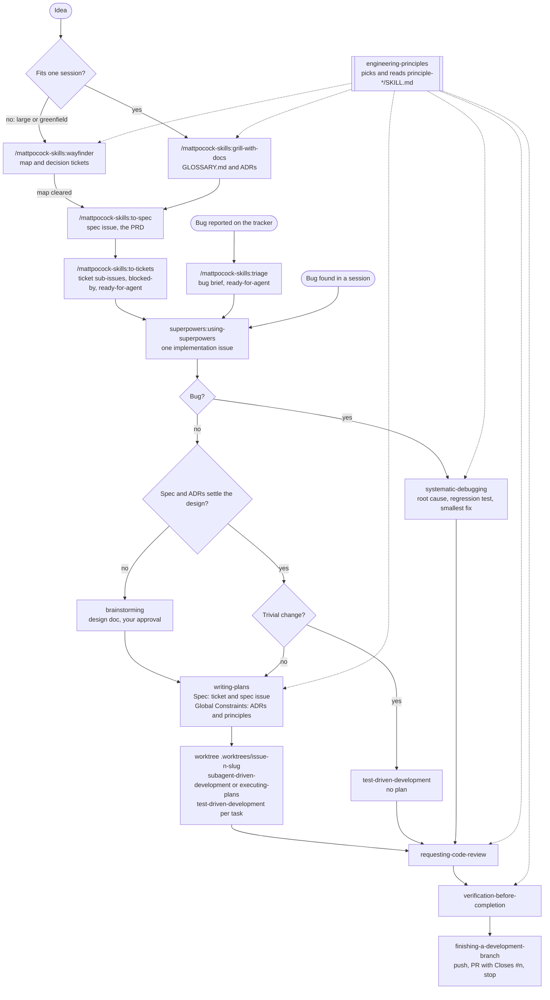

# Skills template

A Claude Code project template that pairs three skill systems, one owner per stage:

| System | Owns | When |
| --- | --- | --- |
| **Matt Pocock skills** (`mattpocock-skills` plugin) | what to build and why: discovery, domain model, spec, tickets | before implementation |
| **Superpowers** (`superpowers` plugin) | how it gets built: the only implementation orchestrator | every implementation issue |
| **Pstack principles** (vendored, through `engineering-principles`) | engineering standards that guide how well it is built | throughout, never as a workflow |

Agents read [CLAUDE.md](CLAUDE.md) (always loaded) and [docs/workflow.md](docs/workflow.md) (detailed rules). This README is the overview for people.

## Workflow



Discovery produces decisions and work items, never code: decision tickets and the spec issue feed `to-tickets`, and only tickets and bug briefs reach Superpowers.

## Commands

| Stage | You type | Produces |
| --- | --- | --- |
| Small or well-scoped discovery | `/mattpocock-skills:grill-with-docs <idea>` | answers, `GLOSSARY.md` terms, ADRs in `docs/adr/` |
| Large or greenfield discovery | `/mattpocock-skills:wayfinder <destination>` | a `wayfinder:map` issue and decision tickets, resolved one per session |
| Specification | `/mattpocock-skills:to-spec` | the spec issue (PRD) |
| Implementation issues | `/mattpocock-skills:to-tickets` | ticket sub-issues with acceptance criteria and blocked-by links |
| Bug intake | `/mattpocock-skills:triage` | a bug brief labelled `ready-for-agent`, or a request for information |
| Implementation | `/superpowers:using-superpowers implement #<n>` | plan, worktree, reviewed and verified PR with `Closes #<n>` |
| A bug in front of you | `/superpowers:using-superpowers` and describe it | systematic debugging, regression test, fix, PR |
| Principles, by hand | `/engineering-principles <task>` or `/principle-<name>` | the principles that apply, read in full |
| Tracker setup changes | `/mattpocock-skills:setup-matt-pocock-skills` | updates `docs/agents/*` and the Agent skills block in CLAUDE.md |

Superpowers also loads `using-superpowers` at the start of every session, so implementation requests route through it even without the command. Plugin skills always carry their prefix: `/mattpocock-skills:grill-with-docs`, not `/grill-with-docs`.

## Example: a feature from idea to PR

1. `/mattpocock-skills:grill-with-docs Visitors should be able to subscribe to our newsletter.` The grilling settles that a **Subscriber** is not a **Contact** and that signups need double opt-in. Both terms land in `GLOSSARY.md`; the choice of email provider, hard to reverse, becomes `docs/adr/0001-newsletter-provider.md`.
2. `/mattpocock-skills:to-spec` publishes spec issue #10, "Newsletter signup".
3. `/mattpocock-skills:to-tickets` splits it into #11 "Signup form and endpoint" and #12 "Confirmation email" (blocked by #11), both sub-issues of #10.
4. In a new session, `/superpowers:using-superpowers implement #11`. Superpowers reads #11, #10, ADR-0001 and the glossary. The design is settled, so it skips brainstorming and writes the plan. `engineering-principles` adds boundary-discipline (untrusted email input), make-operations-idempotent (double submits) and test-behavior-not-implementation to its Global Constraints.
5. In `.worktrees/issue-11-signup-form`, subagents build the tasks test-first. Code review and verification follow, then a pushed branch and a PR with `Closes #11`. Merging is yours; once #11 closes, #12 is unblocked.

## Starting a new project from this template

1. Create the repository from the template: `gh repo create <name> --template MatiasOS/skills-template --private --clone` (or "Use this template" on GitHub).
2. Install the two plugins once per clone. The settings declare them, but declaring does not download them:

   ```bash
   claude plugin install superpowers@claude-plugins-official --scope project
   claude plugin install mattpocock-skills@claude-plugins-official --scope project
   ```

3. Create the tracker labels: `scripts/bootstrap-github-labels.sh --dry-run`, then without `--dry-run`. Labels do not copy with a GitHub template.
4. Replace the placeholder paragraph at the top of `CLAUDE.md` with what the project is.
5. To use a tracker other than GitHub Issues, run `/mattpocock-skills:setup-matt-pocock-skills`.
6. Start Claude Code at the repository root and trust the folder.

## What's in the repository

```text
CLAUDE.md                          rules every session loads
README.md                          this overview
docs/workflow.md                   detailed rules: vocabulary, readiness, plan contract, bug flows, blocked skills
docs/agents/issue-tracker.md       how skills talk to GitHub Issues (from setup-matt-pocock-skills)
docs/agents/triage-labels.md       triage label vocabulary
docs/agents/domain.md              where the glossary and ADRs live
.claude/settings.json              plugins, skill overrides, deny rules, env
.claude/skills/engineering-principles/   the Pstack router, plus PSTACK-PROVENANCE.md and PSTACK-LICENSE
.claude/skills/principle-*/        24 Pstack principles, verbatim
scripts/bootstrap-github-labels.sh triage, category and wayfinder labels, idempotent
.gitignore                         includes docs/superpowers/, .superpowers/, .worktrees/
```

Created per project, when first needed: `GLOSSARY.md` and `docs/adr/` (by `domain-modeling`), and the local, gitignored `docs/superpowers/` (by Superpowers).

## Dependencies

Checked on 2026-11-19 with Claude Code 2.1.293.

| Dependency | Pinned at | Installed as | Status |
| --- | --- | --- | --- |
| Superpowers | 7.0.2, `obra/superpowers@22f0b46`, from `claude-plugins-official` | plugin, project scope | installed and loading |
| Matt Pocock skills | 1.3.1, `mattpocock/skills@49dd158`, from `claude-plugins-official` | plugin, project scope | installed and loading |
| Pstack principles | 0.15.44, `cursor/plugins@50b3a32` | 24 files vendored verbatim | present, `diff`-checked against upstream |
| `engineering-principles` | this repository | project skill | loading; picks and reads principles by path |
| `gh` | 2.94 or later (sub-issues, blocked-by) | system | needed by the tracker skills |

Nothing required is missing. Two steps stay manual on every new clone: the plugin installs and the label script. Pstack's orchestration (`/poteto-mode`, its playbooks and agents) is left out on purpose.

Updates: the official marketplace keeps both plugins updated by default. The Pstack copy updates by hand, following `.claude/skills/engineering-principles/PSTACK-PROVENANCE.md`.

## Known limitations

Each item was checked with headless Claude Code sessions on 2026-11-19 unless it says otherwise.

- **Deny rules bind the model, not you.** The model's calls to `mattpocock-skills:tdd`, `:diagnosing-bugs`, `:code-review`, `:implement`, `:implement-spec` and `:ask-matt` are denied, with or without arguments. The first three still appear in the model's skill list. Typing `/mattpocock-skills:<name>` yourself still runs any of them, and no setting blocks a single skill of an enabled plugin.
- **One install method per machine.** Matt Pocock recommends either the plugin or skills.sh. If you also have his skills from skills.sh in `~/.claude/skills`, this project turns those copies off (`skillOverrides`), so each skill shows once, under its plugin name. Bare-name calls inside his skills, such as `grill-with-docs` loading `grilling`, resolve to the plugin copies. Your other repositories keep using the skills.sh copies.
- **Discovery skills are user-invoked.** `grill-with-docs`, `wayfinder`, `to-spec`, `to-tickets`, `triage` and `setup-matt-pocock-skills` never appear in the model's skill list; you start them.
- **`triage` posts an AI-disclaimer line** that a global no-attribution commit hook rejects. CLAUDE.md tells it to leave the line out. Untested against a live tracker.
- **`to-spec` labels the spec issue `ready-for-agent`**, the same label as the tickets. CLAUDE.md's definition of an implementation issue (a ticket or a bug brief, never the spec) keeps Superpowers off the spec.
- **Superpowers is in every session.** Its SessionStart hook loads `using-superpowers` into discovery sessions too. CLAUDE.md keeps brainstorming out of discovery; a test run of `grill-with-docs` went straight to grilling.
- **Plans and design docs stay on one machine.** They are gitignored, against Superpowers' default of committing them. Anything worth keeping goes to an ADR or the issue.
- **`.env` protection covers the root only**: `.env`, `.env.local` and `.env.*.local` reads are denied; nested env files are not.
- **The full implementation loop has not run on a real issue yet.** Plugin loading, skill blocking, bare-name resolution, principle selection and a dry walkthrough of the rules were tested; a ticket taken all the way to a PR was not.
